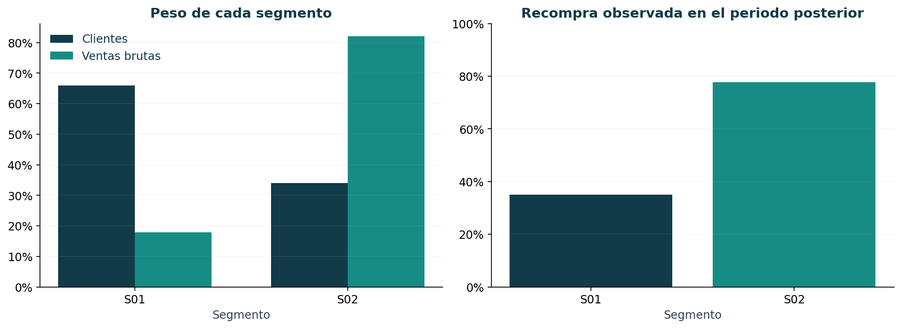
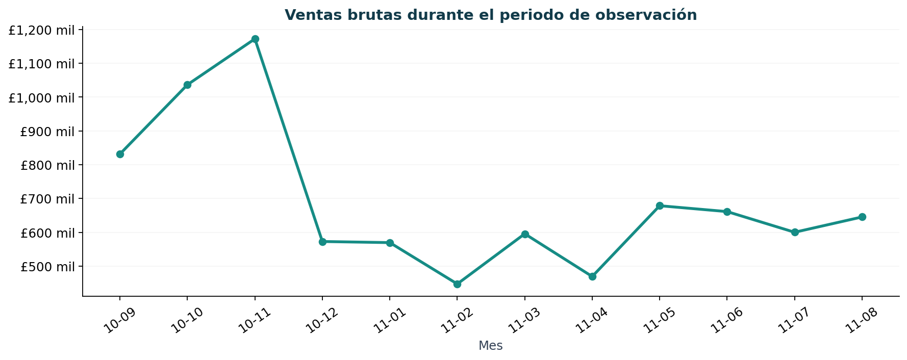

# Segmentación de clientes con Python

**El 34,0 % de los clientes concentra el 82,1 % de las ventas brutas.** Su recompra en los
90 días posteriores fue del 77,7 %, frente al 35,0 % del grupo de menor actividad. Estos
resultados orientan dos pruebas comerciales: fidelización para los compradores recurrentes
y reactivación para quienes compran poco y llevan más tiempo sin volver.

Análisis de compras con **Python y pandas**, desde la calidad de datos hasta las recomendaciones
comerciales. **Scikit-learn** complementa el análisis con agrupamientos de clientes y evaluación
de su estabilidad.

| Clientes analizados | Pedidos observados | Ventas brutas · GBP | Gasto del 10 % superior |
|---:|---:|---:|---:|
| 4 335 | 17 822 | £8 279 871,60 | 60,3 % |



[Resumen ejecutivo](reports/executive_summary.md) · [Análisis paso a paso](notebooks/) ·
[Metodología](docs/methodology.md) · [Orden del proyecto](docs/roadmap.md)

## Qué decisión ayuda a tomar

Una tienda necesita distribuir sus acciones comerciales según el comportamiento de compra.
El proyecto responde **quién compra, cuánto aporta, con qué frecuencia regresa y qué acción
conviene probar en cada grupo**.

El caso se trabaja con transacciones históricas reales de **Online Retail II**, una tienda
británica con compradores mayoristas. La observación abarca septiembre de 2010 a agosto
de 2011. Los siguientes 90 días se reservan para observar recompra, sin utilizarlos para
construir los segmentos.

## Qué encontramos

| Segmento | Clientes | Peso en clientes | Peso en ventas brutas | Recompra posterior | Acción para probar |
|---|---:|---:|---:|---:|---|
| S01 · Baja frecuencia distante | 2 861 | 66,0 % | 17,9 % | 35,0 % | Incentivo de recompra, con grupo de control. |
| S02 · Recurrentes de alto gasto | 1 474 | 34,0 % | 82,1 % | 77,7 % | Beneficios de fidelización, midiendo recompra y margen. |

En S01 la mediana es **1 pedido y 192 días desde la última compra**. En S02 es **6 pedidos
y 29 días**. Los nombres describen las medianas del grupo, no a cada integrante por separado.

Además, el **63,7 %** de los clientes realizó más de un pedido durante la observación.
La concentración del gasto justifica estudiar la cartera por perfiles antes de enviar
las mismas promociones a todos. La recompra posterior es una observación, no el resultado
de una campaña aplicada.

## Cómo se llegó al resultado

| Paso | Trabajo con Python | Evidencia |
|---|---|---|
| 1. Validar | Revisar 1 067 371 líneas, resolver el solapamiento entre hojas y registrar exclusiones. | [Calidad](notebooks/01_data_quality.ipynb) |
| 2. Explorar | Analizar ventas mensuales, compras repetidas y concentración del gasto. | [Análisis comercial](notebooks/02_exploratory_analysis.ipynb) |
| 3. Resumir | Crear una fila por cliente con recencia, frecuencia y gasto bruto. | [Indicadores RFM](notebooks/03_rfm_features.ipynb) |
| 4. Agrupar | Comparar KMeans y Ward, con 2 a 6 grupos. | [Evaluación](notebooks/04_clustering_evaluation.ipynb) |
| 5. Interpretar | Describir los segmentos y contrastar sus compras posteriores. | [Perfiles](notebooks/05_segment_profiles.ipynb) |

Se identificaron **22 523 copias entre hojas**. Después de resolverlas y aplicar las reglas
de calidad, quedaron **809 491 líneas válidas** del historial completo. De ellas, **379 460**
pertenecen al año de observación e incluyen compras y cancelaciones. El detalle se puede
reconciliar en el [reporte de calidad](reports/quality_report.json).



### Machine learning como complemento

Se aplicó una transformación logarítmica y escalado a RFM. Entre los candidatos KMeans que
cumplieron los mínimos de tamaño y estabilidad, **dos grupos** lograron el mayor silhouette
**(0,466)** y un ARI medio por submuestreo de **0,989**. No se fijaron nombres ni cantidad
de segmentos antes de analizar los resultados.

Ward con dos grupos obtuvo un silhouette ligeramente mayor **(0,469)**. Se conserva como
referencia; KMeans permite asignar clientes adicionales mediante un proceso reutilizable.
La regla de selección y sus límites están en la [metodología](docs/methodology.md).

## Explorar el dashboard

El dashboard incluye **Resumen**, **Segmentos**, **Clientes** y **Método**. Permite filtrar
clientes por segmento y país y exportar la selección a CSV. Los resúmenes se pueden abrir
con los informes incluidos; la tabla individual se genera al ejecutar el proceso completo.

## Ejecutar en tu equipo

Requiere **Python 3.11 o superior**. La ejecución publicada se verificó con Python 3.12.
Desde una terminal:

```bash
git clone https://github.com/Maxi-ING/ClasificacionClientes.git
cd ClasificacionClientes
git switch dev
python -m venv .venv
```

Activa el entorno:

```powershell
# Windows · PowerShell
.venv\Scripts\Activate.ps1
```

```bash
# macOS / Linux
source .venv/bin/activate
```

Instala y ejecuta desde la raíz del repositorio:

```bash
python -m pip install -e ".[dev]" -c constraints.txt
python -m customer_segmentation.pipeline
python -m streamlit run app/dashboard.py
```

La primera ejecución descarga aproximadamente 43,5 MB y lee ambas hojas del Excel.
Las siguientes reutilizan la caché. El avance aparece en seis pasos numerados.
La terminal de Streamlit muestra la dirección local para abrir el dashboard.

Para leer y ejecutar los notebooks, selecciona el intérprete `.venv` en VS Code o en tu editor
de notebooks. Empieza por `01` y continúa hasta `05`, después de ejecutar el proceso completo.

### Verificación

```bash
python -m pytest -q
python -m ruff check .
```

Las pruebas comprueban casos conocidos de limpieza, recencia, pedidos distintos, cancelaciones,
periodos, denominadores de recompra, exportación del modelo y navegación del dashboard.
No necesitan descargar el dataset. GitHub ejecuta las mismas verificaciones mediante Actions.

## Dónde está cada parte

| Carpeta | Contenido |
|---|---|
| `notebooks/` | Análisis explicado y resultados visibles, en orden de lectura. |
| `src/customer_segmentation/` | Funciones reutilizables y proceso completo. |
| `config/` | Fechas, semillas y parámetros editables. |
| `data/` | Documentación de fuente y datos generados localmente. |
| `reports/` | Hallazgos, tablas agregadas, gráficos y metadatos de ejecución. |
| `models/` | Modelo y metadatos generados localmente. |
| `app/` | Dashboard en Streamlit. |
| `tests/` | Verificación de cálculos y funcionamiento. |

Los nombres indican una responsabilidad. Los notebooks explican; las funciones del paquete
ejecutan el trabajo. El [recorrido del proyecto](docs/roadmap.md) conecta cada etapa con sus archivos.

## Alcance y fuente

El gasto se expresa en **GBP** y representa compras brutas. Las cancelaciones se informan
aparte. Los registros sin ID de cliente no se asignan a segmentos. El análisis no mide
rentabilidad ni efecto de campañas; las acciones propuestas requieren experimentación.
Los resultados corresponden a este periodo histórico y a esta tienda.

**Fuente:** Chen, D. (2012). [Online Retail II](https://doi.org/10.24432/C5CG6D).
UCI Machine Learning Repository. Datos bajo [CC BY 4.0](https://creativecommons.org/licenses/by/4.0/).
Consulta el [diccionario y la comparación de fuentes](data/README.md).
